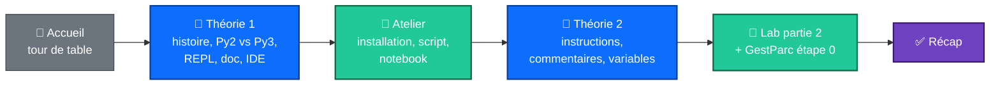
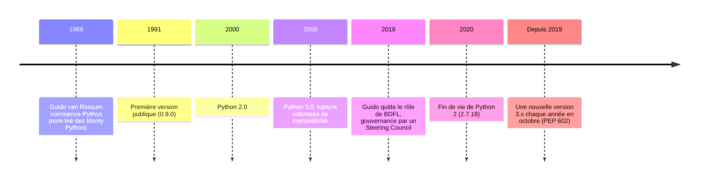
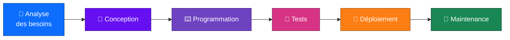
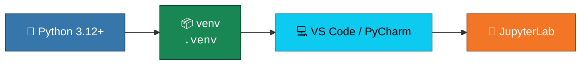

<div align="center">

# 🐍 Séance 1 — Présentation du langage et installation

**Situer Python · Installer son environnement · Écrire ses premières variables**


</div>

---

## 🎯 Objectifs de la séance

| | Compétence |
|:-:|---|
| 🧭 | Situer Python : **histoire**, **versions**, **usages** |
| 💬 | Utiliser l'interpréteur interactif (**REPL**) et la **documentation officielle** |
| 🧰 | Installer un environnement complet : **Python**, **IDE**, **JupyterLab** |
| ▶️ | Écrire et exécuter un premier **script** et un premier **notebook** |
| ✍️ | Écrire des instructions, des **commentaires** et des **variables** |

---

## 🗺️ Plan de la séance



---

## 📖 Théorie 1 : découvrir Python

### 🕰️ Python en quelques dates



### 💡 Pourquoi Python ?

- 📖 **Lisible** : la syntaxe ressemble à du pseudo-code et l'indentation fait partie du langage.
- 🔀 **Polyvalent** : un seul langage pour des besoins très différents.
- 🔋 **« Batteries included »** : une bibliothèque standard très riche.
- 🌍 **Écosystème** : plus de 500 000 paquets sur PyPI.

| Profil | Usage typique |
|---|---|
| 🖧 Admin système et réseau | automatisation, Ansible, analyse de logs |
| 📊 Data | pandas, NumPy, Jupyter, machine learning |
| 💻 Développeur | web (Django, FastAPI), outils, tests |
| 📋 Chef de projet | scripts de reporting, extraction de données |

### 🧮 De l'algorithme au programme

Un **algorithme** est une suite d'actions indépendante de tout langage, en 3 temps : **saisie des données → traitements → restitution des résultats**. Un **programme** traduit cet algorithme dans une syntaxe précise, ici Python.

<table>
<tr><th>📝 Pseudo-code</th><th>🐍 Python</th></tr>
<tr><td>

```text
ALGORITHME Moyenne
VARIABLES n1, n2, n3, moy : réels
DÉBUT
  n1 ← 12
  n2 ← 15.5
  n3 ← 9
  moy ← (n1 + n2 + n3) / 3
  ÉCRIRE moy
FIN
```

</td><td>

```python
n1 = 12
n2 = 15.5
n3 = 9
moy = (n1 + n2 + n3) / 3
print(moy)
# 12.166666666666666
```

</td></tr>
</table>

> [!NOTE]
> La flèche `←` devient `=`, l'affectation. Il n'y a pas de déclaration de type : Python déduit le type des valeurs.

### ⚖️ Langage compilé ou interprété ?

| | Compilé (C, C++, Rust) | Interprété (**Python**, R, JavaScript) |
|---|---|---|
| **Exécution** | traduit une fois en code machine | lu et exécuté à la volée |
| **Rapidité** | ✅ très rapide | ❌ plus lent |
| **Portabilité** | ❌ recompiler pour chaque système | ✅ le même script tourne partout |
| **Mise au point** | cycle écrire → compiler → tester | ✅ test immédiat, ligne par ligne |

> [!TIP]
> Python est plus lent, mais ses bibliothèques de calcul (NumPy, pandas…) sont écrites en C : le code critique s'exécute à la vitesse d'un langage compilé.

### 🏗️ Les 6 étapes du génie logiciel



La programmation n'est qu'**une étape sur six** : un code clair et testé coûte beaucoup moins cher à maintenir.

### 🆚 Python 2 ou Python 3 ?

| | Python 2 ❌ | Python 3 ✅ |
|---|---|---|
| Affichage | `print "Bonjour"` (instruction) | `print("Bonjour")` (fonction) |
| Division | `7 / 2` → `3` | `7 / 2` → `3.5` |
| Texte | ASCII par défaut | Unicode par défaut |
| Saisie | `raw_input()` | `input()` |
| Statut | fin de vie depuis 2020 | version actuelle |

> [!WARNING]
> Un tutoriel ou une réponse en ligne qui écrit `print "..."` sans parenthèses est **obsolète**.

### 💬 Le REPL (Read – Eval – Print – Loop)

```python
$ python
>>> 2 + 3
5
>>> 7 / 2
3.5
>>> "Gest" + "Parc"
'GestParc'
>>> help(print)     # aide sur une fonction
>>> import this     # le Zen of Python
>>> exit()
```

- **Lancer :** `py` ou `python` sous Windows, `python3` sous Linux et macOS.
- **Quitter :** `exit()`, `Ctrl+D` sous Linux et macOS, `Ctrl+Z` puis Entrée sous Windows.

📚 **Documentation :** [docs.python.org/fr/3](https://docs.python.org/fr/3/). Prenez le réflexe de consulter la documentation officielle avant le forum.

### 💻 Choisir son environnement

| Outil | Points forts | Pour qui ? |
|---|---|---|
| **VS Code** + extensions Python et Jupyter | léger, gratuit, notebooks intégrés | ⭐ outil de référence de la formation |
| **PyCharm** | très complet, refactoring, debugger avancé | développeurs |
| **JupyterLab** | code, texte et graphiques, exécution par cellules | data, exploration, labs |
| **IDLE** | fourni avec Python | dépannage seulement |

Dans cette formation, les labs sont des notebooks `.ipynb` et les programmes des scripts `.py`.

---

## 🧰 Atelier d'installation



```bash
python --version                     # 1. Vérifier Python (3.12+) ; python3 sous Linux/macOS
mkdir gestparc && cd gestparc        # 2. Créer le dossier du projet
python -m pip install jupyterlab     # 3. Installer JupyterLab
python check_install.py              # 4. Lancer le contrôle d'installation
```

> [!TIP]
> Sous Windows, cochez **« Add python.exe to PATH »** dans l'installeur. Sous Linux, n'utilisez jamais `sudo pip install` : installez les paquets **dans un venv**.

---

## 📖 Théorie 2 : instructions, commentaires, variables

Un script s'exécute **de haut en bas**, une instruction par ligne.

```python
# premier_script.py
print("Inventaire GestParc")
print("Nombre de postes :", 42)   # plusieurs valeurs → séparées par un espace
print(10 + 32)
```

### 💬 Les commentaires

```python
# ✅ Bon commentaire : il explique POURQUOI
# On garde 10 % de marge pour les mises à jour système.
reserved_gb = 50

# ❌ Mauvais commentaire : il répète le code
x = 50  # x vaut 50
```

> [!NOTE]
> Règle de la formation : le **code et les noms en anglais**, les **commentaires en français**.

### 📦 Les variables et les opérateurs

Une variable est un **nom qui désigne une valeur**. On la crée par affectation avec `=`.

```python
hostname = "srv-web-01"
cpu_count = 8
ram_gb = 31.4
is_online = True
print(hostname, "a", cpu_count, "cœurs")   # srv-web-01 a 8 cœurs
```

| Opérateur | Sens | Exemple | Résultat |
|:-:|---|---|:-:|
| `+` `-` `*` | addition, soustraction, multiplication | `8 * 4` | `32` |
| `/` | division (toujours décimale) | `7 / 2` | `3.5` |
| `//` | division entière | `7 // 2` | `3` |
| `%` | reste (modulo) | `7 % 2` | `1` |
| `**` | puissance | `2 ** 10` | `1024` |

### 🏷️ Bien nommer ses variables

| ✅ Correct | ❌ Incorrect | Pourquoi |
|---|---|---|
| `second_server` | `2nd_server` | un nom ne commence pas par un chiffre |
| `disk_usage` | `disk-usage` | `-` est l'opérateur de soustraction |
| `class_name` | `class` | mot réservé du langage |
| `ticket_id` | `t` | nom non explicite |
| `server_count` | `ServerCount` | convention **snake_case** : minuscules et `_` |

- Python **distingue les majuscules** : `Total` et `total` sont deux variables différentes.
- Par convention, les **constantes s'écrivent en MAJUSCULES** : `APP_NAME = "GestParc"`.

---

## ⚠️ Pièges fréquents de la première soirée

```python
>>> print "Bonjour"
SyntaxError: Missing parentheses in call to 'print'. Did you mean print(...)?

>>> print(nb_servers)
NameError: name 'nb_servers' is not defined

>>> Hostname = "srv-01"
>>> print(hostname)
NameError: name 'hostname' is not defined. Did you mean: 'Hostname'?
```

> [!IMPORTANT]
> Lisez un message d'erreur **en partant de la dernière ligne** : elle donne le **type de l'erreur** et une **explication**.

---

## 🏋️ Exercices du lab

| # | Exercice | Difficulté | Notion clé |
|:-:|---|:-:|---|
| 1 | Durée d'une séance | ⭐ | calculs simples |
| 2 | Taux d'occupation d'un disque | ⭐ | pourcentage, `/` |
| 3 | Budget d'achat de postes (TVA 19 %) | ⭐⭐ | HT / TVA / TTC |
| 4 | Basculement de serveurs | ⭐⭐ | échange avec `temp` |
| 5 | Corriger les noms de variables | ⭐⭐ | `SyntaxError`, mots réservés |
| 6 | Lire un message d'erreur | ⭐⭐⭐ | `NameError`, casse |
| 🧩 | **Synthèse** : durée d'analyse d'un fichier de logs | ⭐⭐⭐ | `//`, `%`, conversions de durée |

> [!NOTE]
> Chaque exercice est suivi d'une cellule **✅ Vérification** contenant des `assert`. Si rien ne s'affiche ou si ✅ apparaît, la réponse est correcte. Des indices 💡 sont repliés sous chaque énoncé.

---

## 🛠️ Projet fil rouge GestParc : étape 0

**GestParc** est l'application de gestion de parc informatique construite tout au long de la formation : inventaire, affectations, garanties, tickets, base de données, puis interface graphique.

```text
gestparc/
├── .venv/
├── README.md
└── main.py   →   ========================================
                  GestParc v0.1.0
                  Gestion de parc informatique
                  Auteur : Votre nom
                  ========================================
```

---

## ✅ Récapitulatif

| | À retenir |
|:-:|---|
| 🐍 | **Python 3 uniquement** : Python 2 est en fin de vie depuis 2020 |
| 🧪 | **REPL** pour tester, **script `.py`** pour les programmes, **notebook** pour explorer |
| ✍️ | `print()` affiche, `#` commente, `=` affecte une valeur à un nom |
| 🏷️ | des noms en **snake_case**, explicites et en anglais |

📚 **Pour la prochaine fois (facultatif) :** lire les sections 1 à 3 du [tutoriel officiel](https://docs.python.org/fr/3/tutorial/).

➡️ **Séance 2 :** types, séquences, dictionnaires, références et mutabilité.

---

<div align="center">

📓 **Notebook :** [`S01_lab_enonce.ipynb`](S01_lab_enonce.ipynb) · ⏭️ [Séance 2](../S02/)

</div>
