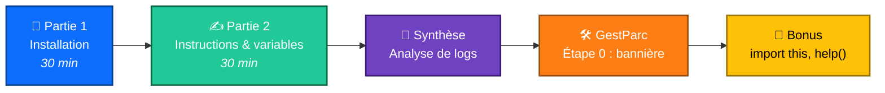
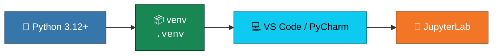

<div align="center">

# 🐍 Séance 1 — Premiers pas avec Python

**Installer son environnement · Exécuter du code · Écrire ses premières variables**


</div>

---

## 🎯 Objectifs

| | Compétence |
|:-:|---|
| 🧰 | Installer **Python**, un **IDE**, un **venv** et **JupyterLab** |
| ▶️ | Exécuter du code dans le **REPL**, un **script** et un **notebook** |
| ✍️ | Écrire des instructions, des **commentaires** et des **variables** |
| 🚨 | Lire un **message d'erreur** |

---

## 🗺️ Déroulé du lab



---

## 🧰 Partie 1 : la chaîne d'installation



> [!TIP]
> Sous Windows, cochez **« Add python.exe to PATH »** dans l'installeur. Sous Linux, n'utilisez jamais `sudo pip install` : installez les paquets **dans un venv**.

---

## ✍️ Partie 2 : l'essentiel en un coup d'œil

```python
# Un commentaire commence par #
hostname = "srv-web-01"        # affectation : nom = valeur (snake_case)
disk_free_gb = 512 - 389       # opérateurs : +  -  *  /  //  %  **
print("Libre :", disk_free_gb) # print affiche plusieurs valeurs
```

| Opérateur | Rôle | Exemple | Résultat |
|:-:|---|---|:-:|
| `/` | division décimale | `7 / 2` | `3.5` |
| `//` | division entière | `7 // 2` | `3` |
| `%` | reste (modulo) | `7 % 2` | `1` |
| `**` | puissance | `2 ** 32` | `4294967296` |

---

## 🏋️ Exercices

| # | Exercice | Difficulté | Notion clé |
|:-:|---|:-:|---|
| 1 | Durée d'une séance | ⭐ | calculs simples |
| 2 | Taux d'occupation d'un disque | ⭐ | pourcentage, `/` |
| 3 | Budget d'achat de postes (TVA 19 %) | ⭐⭐ | HT / TVA / TTC |
| 4 | Basculement de serveurs | ⭐⭐ | échange avec `temp` |
| 5 | Corriger les noms de variables | ⭐⭐ | `SyntaxError`, mots réservés |
| 6 | Lire un message d'erreur | ⭐⭐⭐ | `NameError`, casse |
| 🧩 | **Synthèse** : durée d'analyse d'un fichier de logs | ⭐⭐⭐ | `//`, `%`, conversions de durée |

> [!NOTE]
> Chaque exercice est suivi d'une cellule **✅ Vérification**. S'il n'y a pas d'`AssertionError`, la réponse est correcte. Des indices 💡 sont repliés sous chaque énoncé.

---

## 🛠️ Projet fil rouge GestParc : étape 0

```text
gestparc/
├── .venv/
├── README.md
└── main.py   →   ========================================
                  GestParc v0.1.0
                  Gestion de parc informatique
                  Auteur : Votre nom
                  ========================================
```

➡️ **Prochaine étape (S2)** : représenter l'inventaire avec des listes, des tuples et des dictionnaires.

---

<div align="center">

📓 **Notebook :** [`S01_lab_enonce.ipynb`](S01_lab_enonce.ipynb) · ⏭️ [Séance 2](../S02/)

</div>
