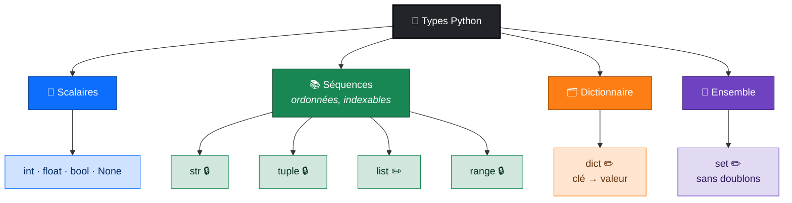
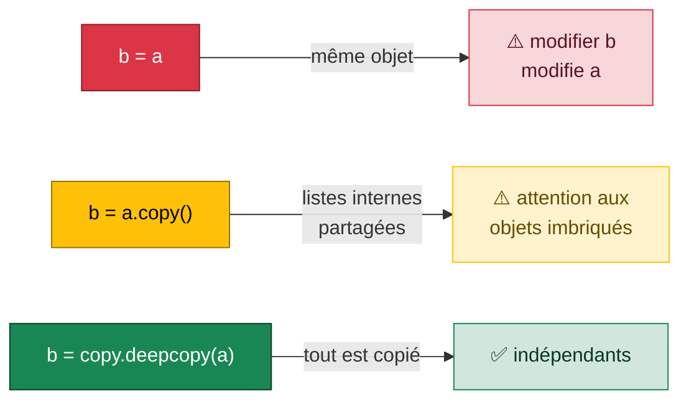

<div align="center">

# 🧱 Séance 2 — Syntaxe de base

**Types · f-strings · Séquences · Dictionnaires · Ensembles · Références**


</div>

---

## 🎯 Objectifs

| | Compétence |
|:-:|---|
| 🔢 | Utiliser les **types de base** et les **conversions** |
| 🖨️ | Formater un affichage avec les **f-strings** |
| 📚 | Manipuler `str`, `list`, `tuple`, `range`, `dict` et `set` |
| 🔗 | Maîtriser l'**affectation par référence** et les **copies** |
| 📤 | Décomposer une séquence (**unpacking**) |

---

## 🗺️ Les structures de données de Python



<p align="center">🔒 immuable &nbsp;·&nbsp; ✏️ modifiable</p>

---

## ⚡ Aide-mémoire

<table>
<tr><th>🖨️ f-strings</th><th>✂️ Slicing</th><th>🎯 Ensembles</th></tr>
<tr><td>

```python
f"{name:<12}"   # gauche, 12 car.
f"{x:>5.1f}"    # droite, 1 déc.
f"{load:.1%}"   # pourcentage
f"{n:,}"        # 17,400
```

</td><td>

```python
s[0]      # premier
s[-1]     # dernier
s[:10]    # 10 premiers
s[::2]    # 1 sur 2
```

</td><td>

```python
a & b   # intersection
a | b   # union
a - b   # différence
```

</td></tr>
</table>

### 🔗 Alias, copie superficielle ou copie profonde ?



---

## 🏋️ Exercices

| # | Exercice | Difficulté | Notion clé |
|:-:|---|:-:|---|
| 1 | Variables typées | ⭐ | annotations, `None` |
| 2 | Lire un fichier de configuration | ⭐ | `int()`, `float()` |
| 3 | Ligne de rapport de supervision | ⭐⭐ | alignement f-string |
| 4 | Traiter une saisie | ⭐⭐ | `input`, format français |
| 5 | Découper une ligne de log | ⭐ | slicing |
| 6 | Gérer une liste de serveurs | ⭐⭐ | `append`, `insert`, `pop`, `join` |
| 7 | Dictionnaire d'équipement et ensembles | ⭐⭐ | `get`, `&`, `\|`, `-` |
| 8 | Références et copies | ⭐⭐⭐ | `deepcopy` |
| 9 | Décomposition | ⭐⭐ | `a, *rest = seq` |
| 🧩 | **Synthèse** : export de tâches projet | ⭐⭐⭐ | `split`, `set`, f-string |

---

## 🛠️ Projet fil rouge GestParc : étape 1

L'inventaire prend forme : **une liste de dictionnaires**.

```python
inventory = [
    {"asset_tag": "LT-001", "category": "laptop",  "brand": "Dell", "price": 3200.0,  "assigned_to": "Bob"},
    {"asset_tag": "SV-001", "category": "server",  "brand": "HPE",  "price": 18500.0, "assigned_to": None},
    {"asset_tag": "PR-001", "category": "printer", "brand": "HP",   "price": 950.0,   "assigned_to": "Joe"},
]
```

➡️ **Prochaine étape (S3)** : un menu console en boucle pour lister, rechercher et ajouter des équipements.

---

<div align="center">

📓 **Notebook :** [`S02_lab_enonce.ipynb`](S02_lab_enonce.ipynb) · ⏮️ [Séance 1](../S01/) · ⏭️ [Séance 3](../S03/)

</div>
