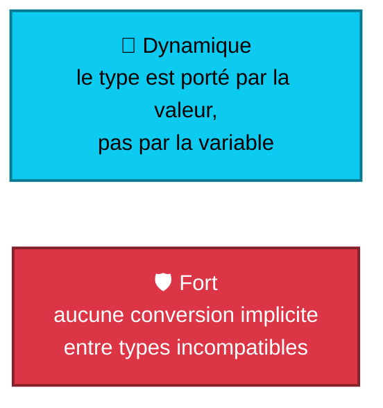
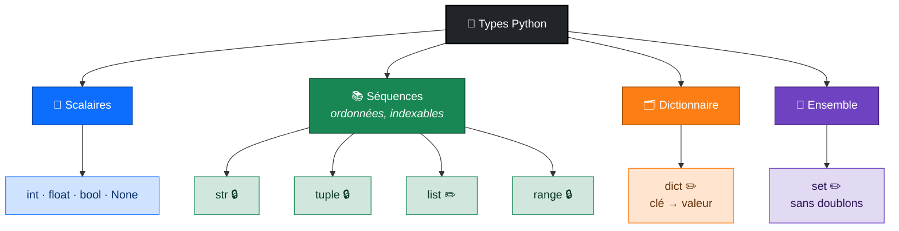
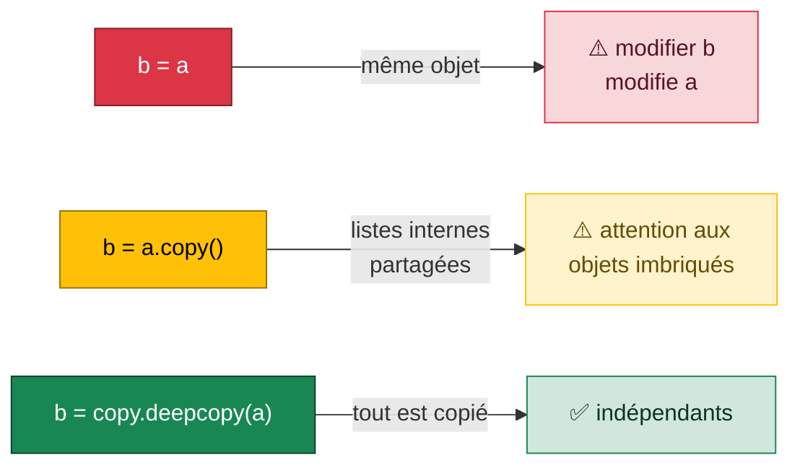

<div align="center">

# 🧱 Séance 2 — Syntaxe de base

**Types · Console et f-strings · Séquences · Dictionnaires · Ensembles · Références**


</div>

---

## 🎯 Objectifs de la séance

| | Compétence |
|:-:|---|
| 🔢 | Connaître les **types de base** et les particularités du **typage** Python |
| 🖨️ | Afficher et saisir des informations, formater avec les **f-strings** |
| 📚 | Manipuler les séquences (`str`, `list`, `tuple`, `range`), les **dictionnaires** et les **ensembles** |
| 🔗 | Comprendre l'**affectation par référence**, la **mutabilité** et les **copies** |
| 📤 | Décomposer une séquence (**unpacking**) |

---

## 🗺️ Plan de la séance


<details>
<summary><b>🧠 Quiz flash : révision de la séance 1</b> (cliquer pour voir les réponses)</summary>

| Question | Réponse |
|---|---|
| Quelle commande affiche la version de Python ? | `python --version` (`py --version`, `python3 --version`) |
| Que vaut `7 // 2` ? Et `7 % 2` ? | `3` et `1` |
| Pourquoi `2nd_server = "srv-02"` provoque-t-il une erreur ? | un nom ne peut pas commencer par un chiffre |
| Qu'affiche `print("RAM", 32, "Go")` ? | `RAM 32 Go` |
| Quelle version ne faut-il plus utiliser ? | Python 2, en fin de vie depuis 2020 |

</details>

---

## 📖 Théorie 1 : types, conversions, console

### 🔢 Les types de base

| Type | Exemple | Usage |
|---|---|---|
| `int` | `cpu_count = 8` | entiers, **sans limite de taille** |
| `float` | `cpu_load = 0.75` | nombres décimaux |
| `str` | `hostname = "srv-web-01"` | texte (Unicode) |
| `bool` | `is_online = True` | vrai / faux |
| `NoneType` | `assigned_to = None` | absence de valeur |

```python
>>> 2 ** 100
1267650600228229401496703205376
>>> 0.1 + 0.2
0.30000000000000004        # ⚠️ précision limitée des flottants
```

### ⚡ Un typage dynamique… et fort



```python
status = "online"          # status désigne un str
status = 1                 # puis un int : autorisé (dynamique)

>>> "Port : " + 8080       # fort : erreur
TypeError: can only concatenate str (not "int") to str
>>> "Port : " + str(8080)
'Port : 8080'
```

### 🔍 Connaître le type et annoter

```python
>>> type(32)
<class 'int'>
>>> isinstance(32, (int, float))    # préféré : tient compte de l'héritage (S9)
True

hostname: str = "srv-web-01"        # type hints : documentation du type attendu
assigned_to: str | None = None
```

> [!NOTE]
> Python **ne vérifie pas** les annotations à l'exécution : ce sont VS Code et des outils comme **mypy** qui s'en servent pour détecter des erreurs. Nous les utiliserons systématiquement à partir des fonctions (S5).

### 🔁 Conversions de types

| Fonction | Exemple | Résultat |
|---|---|---|
| `int()` | `int("8080 ")` | `8080` (espaces tolérés) |
| `float()` | `float("0.75")` | `0.75` |
| `str()` | `str(42)` | `"42"` |
| `bool()` | `bool("")` / `bool("non")` | `False` / `True` |
| `round()` | `round(75.976, 1)` | `76.0` |

> [!WARNING]
> `int("80.5")` lève `ValueError: invalid literal for int()`. Passez d'abord par `float()`.

### 🖨️ Console : `input()`, `print()` et f-strings

```python
prix_ht = float(input("Prix HT : "))     # input renvoie TOUJOURS un str
taux = float(input("Taux de TVA (%) : "))
prix_ttc = prix_ht * (1 + taux / 100)
print(f"Prix TTC : {prix_ttc:.2f} €")    # Prix TTC : 96.00 €
```

| Format | Exemple | Résultat |
|---|---|---|
| Décimales | `f"{75.976:.1f}"` | `76.0` |
| Alignement à droite / à gauche | `f"[{'web':>6}]"` / `f"[{'web':<6}]"` | `[   web]` / `[web   ]` |
| Zéros devant | `f"{20:03d}"` | `020` |
| Milliers | `f"{1250000:,}"` | `1,250,000` |
| Pourcentage | `f"{0.759:.0%}"` | `76%` |
| Débogage | `f"{cores=}"` | `cores=8` |
| `sep` et `end` | `print("a", "b", "c", sep="-", end=" ← fin\n")` | `a-b-c ← fin` |

---

## 📖 Théorie 2 : collections et références

### 🗺️ Les structures de données de Python



<p align="center">🔒 immuable &nbsp;·&nbsp; ✏️ modifiable</p>

Toutes les séquences ont en commun `len()`, l'indexation `[i]`, le slicing `[a:b]`, `in`, `+` et `*`.

### ✂️ Indexation et slicing

```text
t      =  (  2,   6,   8,  10,  15,  26 )
indice :     0    1    2    3    4    5
négatif:    -6   -5   -4   -3   -2   -1
```

| Expression | Résultat | Règle |
|---|---|---|
| `t[0]` / `t[-1]` | `2` / `26` | premier / dernier |
| `t[2:5]` | `(8, 10, 15)` | **la fin est exclue** |
| `t[:4]` / `t[-3:]` | `(2, 6, 8, 10)` / `(10, 15, 26)` | depuis le début / jusqu'à la fin |
| `log[::2]` / `log[::-1]` | un caractère sur deux / chaîne inversée | `[début:fin:pas]` |

```python
t[0] = 99        # TypeError : un tuple n'est pas modifiable
t2 = t + (31, 40)            # mais on peut en construire un nouveau
singleton = (5,)             # ⚠️ la virgule est obligatoire : (5) est un int
```

### 📝 Les listes et les chaînes en pratique

<table>
<tr><th>📋 Listes</th><th>🔤 Chaînes (immuables)</th></tr>
<tr><td>

```python
servers = ["srv-web-01", "srv-db-01"]
servers.append("srv-app-01")  # à la fin
servers.insert(0, "srv-lb-01")# à l'index 0
servers.remove("srv-db-01")   # par valeur
last = servers.pop()          # retire + renvoie
servers.sort()                # trie sur place

15 in notes        # True / False
notes.index(15)    # 1re position
notes.count(15)    # nb d'occurrences
```

</td><td>

```python
s = "Bonjour le monde"
s.upper()      # BONJOUR LE MONDE
s.find("jour") # 3 (ou -1 si absent)
s.count("o")   # 3
s.replace("monde", "Python")
s.startswith("Bon")       # True
" texte ".strip()         # "texte"

"Sara;20;14.5".split(";") # ['Sara','20','14.5']
"-".join(["a", "b"])      # "a-b"
```

</td></tr>
</table>

> [!TIP]
> Testez `x in L` **avant** `L.index(x)` ou `L.remove(x)` pour éviter la `ValueError`. Et `split(";")` est la base de la lecture des fichiers CSV.

### 🗂️ Dictionnaires et 🎯 ensembles

```python
notes = {"Sara": 15.5, "Adam": 12, "Lina": 17}
notes["Sara"]               # 15.5 : accès par la CLÉ
notes.get("Omar", 0)        # 0 : valeur par défaut (notes["Omar"] → KeyError)
notes["Adam"] = 13          # modifie si la clé existe, ajoute sinon
notes.update({"Omar": 11})  # fusionne un autre dictionnaire
del notes["Sara"]           # supprime
for nom, note in notes.items(): ...   # keys(), values(), items()

team_a = {"python", "git", "docker"}
team_b = {"python", "excel"}
team_a & team_b    # intersection : {'python'}
team_a | team_b    # union
team_a - team_b    # différence : {'git', 'docker'}
```

> [!NOTE]
> Les **clés** sont uniques et non mutables (`str`, `int`, `tuple`) ; les **valeurs** peuvent être de n'importe quel type. Depuis Python 3.7, un dictionnaire **conserve l'ordre d'insertion**. Une **liste de dictionnaires** a exactement la forme des données JSON.

### 🔗 Références : alias, copie superficielle, copie profonde

Une variable est une **étiquette posée sur un objet**.



```python
import copy
site = {"name": "Tunis", "servers": ["srv-01", "srv-02"]}
shallow = site.copy()          # ou dict(site), liste.copy(), liste[:]
deep = copy.deepcopy(site)
site["servers"].append("srv-03")
shallow["servers"]   # ['srv-01', 'srv-02', 'srv-03']  ← partagé !
deep["servers"]      # ['srv-01', 'srv-02']            ← indépendant
```

### 📤 La décomposition (unpacking)

```python
hostname, ip, port = "srv-db-01;10.0.0.12;5432".split(";")
first, *others = ["srv-lb-01", "srv-web-01", "srv-web-02"]
a, b = b, a                    # échange sans variable temporaire
```

### 🧭 Quelle collection choisir ?

| | `tuple` | `list` | `str` | `dict` | `set` |
|---|:-:|:-:|:-:|:-:|:-:|
| Écriture | `(1, 2)` | `[1, 2]` | `"ab"` | `{"a": 1}` | `{1, 2}` |
| Modifiable | ❌ | ✅ | ❌ | ✅ | ✅ |
| Accès | indice | indice | indice | clé | `in` |
| Usage type | données fixes, retour multiple | valeurs qui évoluent | texte | fiche, index, comptage | appartenance, sans doublons |

---

## ⚠️ Pièges fréquents

| Piège | Exemple | ✅ Correction |
|---|---|---|
| `input()` renvoie du texte | `input() + 1` → `TypeError` | `int(input()) + 1` |
| Tuple à un élément | `("srv-01")` est un `str` | `("srv-01",)` |
| Méthode de liste et retour | `l = l.sort()` → `None` | `l.sort()` ou `sorted(l)` |
| Clé absente | `d["ram"]` → `KeyError` | `d.get("ram", 0)` |
| Alias involontaire | `b = a` puis `b.append(...)` | `b = a.copy()` |
| `{}` vide | c'est un `dict` | `set()` pour un ensemble vide |

---

## 🏋️ Exercices du lab

| # | Exercice | Difficulté | Notion clé |
|:-:|---|:-:|---|
| 1 | Variables typées | ⭐ | annotations, `None` |
| 2 | Lire un fichier de configuration | ⭐ | `int()`, `float()` |
| 3 | Ligne de rapport de supervision | ⭐⭐ | alignement f-string |
| 4 | Traiter une saisie | ⭐⭐ | `input`, format français |
| 5 | Découper une ligne de log | ⭐ | slicing |
| 6 | Gérer une liste de serveurs | ⭐⭐ | `append`, `insert`, `pop`, `join` |
| 7 | Dictionnaire d'équipement et ensembles | ⭐⭐ | `get`, `&`, `\|`, `-` |
| 8 | Références et copies | ⭐⭐⭐ | `deepcopy` |
| 9 | Décomposition | ⭐⭐ | `a, *rest = seq` |
| 🧩 | **Synthèse** : export de tâches projet | ⭐⭐⭐ | `split`, `set`, f-string |

---

## 🛠️ Projet fil rouge GestParc : étape 1

L'inventaire prend forme : **une liste de dictionnaires**.

```python
inventory = [
    {"asset_tag": "LT-001", "category": "laptop",  "brand": "Dell", "price": 3200.0,  "assigned_to": "Bob"},
    {"asset_tag": "SV-001", "category": "server",  "brand": "HPE",  "price": 18500.0, "assigned_to": None},
    {"asset_tag": "PR-001", "category": "printer", "brand": "HP",   "price": 950.0,   "assigned_to": "Joe"},
]
```

---

## ✅ Récapitulatif

| | À retenir |
|:-:|---|
| 🔢 | types de base `int`, `float`, `str`, `bool` et `None` ; typage **dynamique et fort** |
| 🔍 | `type()`, `isinstance()` et des conversions **explicites** `int()`, `float()`, `str()` |
| 🖨️ | f-strings : `f"{valeur:format}"` |
| ✂️ | séquences `str`, `list`, `tuple`, `range` et slicing `[début:fin:pas]` |
| 🗂️ | `dict` (clé → valeur) et `set` (éléments uniques) |
| 🔗 | variables = étiquettes : attention aux objets modifiables, `copy()` / `deepcopy()` |
| 📤 | unpacking : `a, b = b, a` et `first, *others = ...` |

➡️ **Séance 3 :** conditions et boucles, menu interactif de GestParc.

---

<div align="center">

📓 **Notebook :** [`S02_lab_enonce.ipynb`](S02_lab_enonce.ipynb) · ⏮️ [Séance 1](../S01/) · ⏭️ [Séance 3](../S03/)

</div>
