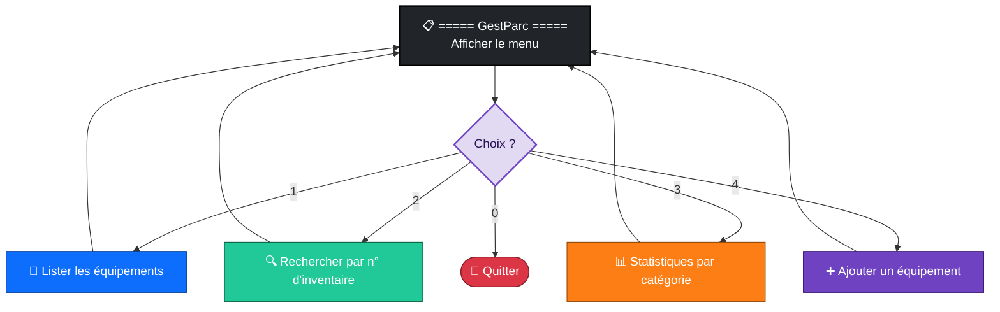

<div align="center">

# 🔀 Séance 3 — Les structures de contrôle

**Conditions · Boucles · Menu interactif**


</div>

---

## 🎯 Objectifs

| | Compétence |
|:-:|---|
| 🔀 | Écrire des conditions avec `if` / `elif` / `else` et l'opérateur **ternaire** |
| 🧮 | Combiner les opérateurs de **comparaison**, **logiques**, `in` et `is` |
| 🔁 | Utiliser `while`, `for`, `range`, `enumerate` et `zip` |
| ⏹️ | Contrôler une boucle avec `break`, `continue`, `pass` et `else` |

---

## 🔀 Partie 1 : conditions


```python
status = "disponible" if assigned_to is None else "affecté"   # ternaire
if 0 <= x < 10 and user is not None: ...                       # comparaisons chaînées
```

> [!IMPORTANT]
> Valent **faux** : `False`, `None`, `0`, `""`, `[]` et `{}`. Pour tester `None`, on écrit `is None` et non `== None`.

---

## 🔁 Partie 2 : boucles

| Outil | Usage | Exemple |
|---|---|---|
| `while` | répéter **tant que** une condition est vraie | nouvelles tentatives d'une API |
| `for … in` | parcourir une séquence | liste de serveurs |
| `range(a, b, pas)` | suite d'entiers | adresses `.50` à `.59` |
| `enumerate(seq, 1)` | index et valeur | liste numérotée |
| `zip(a, b)` | parcourir deux listes **en parallèle** | serveurs et charges |
| `break` / `continue` | sortir / passer au tour suivant | 1ʳᵉ IP libre |
| `for … else` | `else` exécuté si la boucle n'a **pas** fait de `break` | « aucune IP libre » |

---

## 🏋️ Exercices

| # | Exercice | Difficulté | Notion clé |
|:-:|---|:-:|---|
| 1 | Niveau d'alerte d'un disque | ⭐ | `if / elif / else` |
| 2 | Statut avec le ternaire | ⭐ | `a if c else b` |
| 3 | Politique de mots de passe | ⭐⭐ | `and`, `not`, `in` |
| 4 | Règles de pare-feu | ⭐⭐ | conditions combinées |
| 5 | Priorité d'un ticket (P1 à P4) | ⭐⭐⭐ | conditions imbriquées |
| 6 | Capacité totale d'un cluster | ⭐ | `for`, accumulateur |
| 7 | Liste numérotée | ⭐⭐ | `enumerate` |
| 8 | Serveurs surchargés | ⭐⭐ | `zip` |
| 9 | Nouvelles tentatives avec attente croissante | ⭐⭐ | `while`, plafond |
| 10 | Première adresse IP libre | ⭐⭐⭐ | `break`, `for … else` |
| 🧩 | **Synthèse** : statistiques d'un journal d'événements | ⭐⭐⭐ | `continue`, `break`, dictionnaire de compteurs |

---

## 🛠️ Projet fil rouge GestParc : étape 2

GestParc devient **interactif** avec un menu console en boucle :



🚀 **Bonus :** réécrire le menu avec `match` / `case` (Python 3.10+), une table des sous-réseaux et un FizzBuzz version supervision.

➡️ **Prochaine étape (S4)** : TP d'algorithmes et d'automates à états.

---

<div align="center">

📓 **Notebook :** [`S03_lab_enonce.ipynb`](S03_lab_enonce.ipynb) · ⏮️ [Séance 2](../S02/) · ⏭️ [Séance 4](../S04/)

</div>
