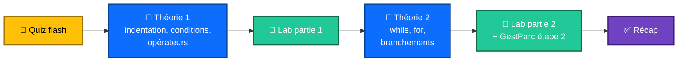
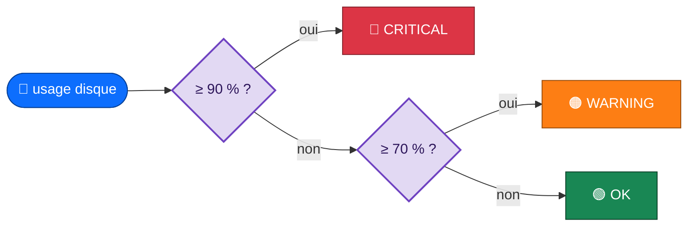
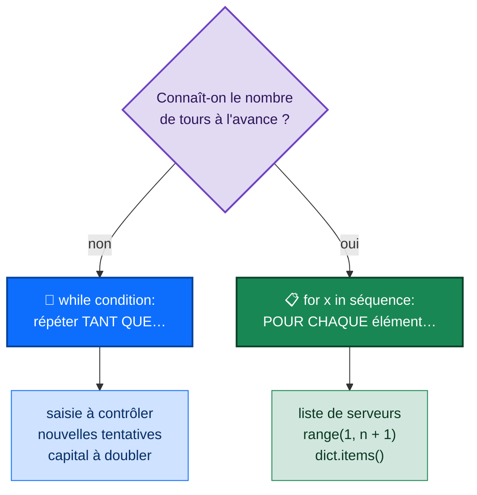

<div align="center">

# 🔀 Séance 3 — Les structures de contrôle

**Indentation · Conditions · Opérateurs · Boucles · Menu interactif**


</div>

---

## 🎯 Objectifs de la séance

| | Compétence |
|:-:|---|
| 📐 | Structurer le code en **blocs** grâce à l'**indentation** |
| 🔀 | Écrire des conditions avec `if` / `elif` / `else` et l'opérateur **ternaire** |
| 🧮 | Utiliser tous les opérateurs : **comparaison**, **logiques**, **appartenance**, **identité** |
| 🔁 | Répéter avec `while` et `for` (`range`, `enumerate`, `zip`) |
| ⏹️ | Contrôler les boucles : `break`, `continue`, `pass` et `else` |

---

## 🗺️ Plan de la séance



<details>
<summary><b>🧠 Quiz flash : révision de la séance 2</b> (cliquer pour voir les réponses)</summary>

| Question | Réponse |
|---|---|
| Que vaut `"srv-web-01"[4:7]` ? | `'web'` |
| Que renvoie `type(input("Âge : "))` ? | `<class 'str'>` : toujours du texte |
| Comment créer un ensemble vide ? | `set()` (et non `{}`, qui est un `dict`) |
| `a = [1, 2]`, `b = a`, `b.append(3)` : que vaut `a` ? | `[1, 2, 3]` : `b` est un alias |
| Échanger `x` et `y` en une ligne ? | `x, y = y, x` |

</details>

---

## 📖 Théorie 1 : indentation, conditions, opérateurs

### 📐 L'indentation fait partie de la syntaxe

```python
disk_usage = 0.93
if disk_usage > 0.9:
    print("Disque presque plein")        # bloc du if
    print("Nettoyage des logs requis")   # même bloc
print("Contrôle terminé")                # hors du bloc
```

- Un bloc commence après `:` et il est indenté de **4 espaces** (PEP 8).
- Toutes les lignes d'un bloc ont la **même indentation**.
- Les blocs s'imbriquent : 4 espaces de plus par niveau.
- Ne **jamais** mélanger tabulations et espaces.

### 🔀 `if` / `elif` / `else`



```python
if disk_usage >= 0.9:
    level = "CRITICAL"
elif disk_usage >= 0.7:
    level = "WARNING"
else:
    level = "OK"
print(f"Disque à {disk_usage:.0%} : {level}")   # Disque à 78% : WARNING
```

> [!NOTE]
> Les conditions sont testées **dans l'ordre** et seul le **premier bloc vrai** est exécuté. Python n'a pas de `switch` classique : on enchaîne les `elif`. Depuis Python 3.10, `match … case` permet de comparer une valeur à des motifs.

### ❓ L'opérateur ternaire

```python
status = "en ligne" if is_online else "hors ligne"
#        valeur_si_vrai  if condition  else valeur_si_faux
```

> [!TIP]
> Réservez le ternaire aux cas simples : au-delà, un `if` classique est plus lisible.

### 🧮 Les opérateurs

| Famille | Opérateurs | Exemple | Résultat |
|---|---|---|:-:|
| ⚖️ Comparaison | `==` `!=` `<` `<=` `>` `>=` | `"web" == "Web"` | `False` |
| 🔗 Chaînage | encadrement | `0 <= port < 1024` | port système ? |
| 🧠 Logiques | `and` `or` `not` | `not tickets` | `True` si la liste est vide |
| 📥 Appartenance | `in` `not in` | `port in {22, 80, 443}` | `True` / `False` |
| 🆔 Identité | `is` `is not` | `assigned_to is None` | même objet ? |

> [!WARNING]
> Les chaînes se comparent **caractère par caractère** : `"10" < "9"` vaut `True`.

> [!IMPORTANT]
> Valent **faux** : `False`, `None`, `0`, `0.0`, `""`, `[]`, `{}` et `set()`.<br/>
> **Évaluation paresseuse** : `user and user["name"]` ne lit pas la clé si `user` est vide.<br/>
> Sur un `dict`, `in` cherche dans les **clés**. On utilise `is` surtout avec `None`.

---

## 📖 Théorie 2 : les boucles

### 🔁 `while` ou `for` ?



<table>
<tr><th>🔄 while : contrôler une saisie</th><th>📋 for : somme de 1 à n</th></tr>
<tr><td>

```python
note = float(input("Note (0-20) : "))
while note < 0 or note > 20:
    print("Note invalide, recommencez")
    note = float(input("Note (0-20) : "))
print("Note enregistrée :", note)
```

</td><td>

```python
somme = 0                  # accumulateur
for i in range(1, n + 1):
    somme += i
print("Somme :", somme)    # n=10 → 55
```

</td></tr>
</table>

> [!WARNING]
> La condition d'un `while` doit **finir par devenir fausse**. Sinon, c'est une boucle infinie : interrompez-la avec `Ctrl+C`.

### 🔢 `range()`, `enumerate()`, `zip()`

| Écriture | Résultat |
|---|---|
| `list(range(4))` | `[0, 1, 2, 3]` |
| `list(range(1, 4))` | `[1, 2, 3]` : **la fin est exclue** |
| `list(range(0, 10, 2))` | `[0, 2, 4, 6, 8]` |
| `list(range(5, 0, -1))` | `[5, 4, 3, 2, 1]` : compte à rebours |
| `for i, s in enumerate(servers, start=1)` | `1 srv-web-01`, `2 srv-db-01` |
| `for s, load in zip(servers, loads)` | parcours de deux listes **en parallèle** |

### 🗂️ Parcourir un dictionnaire

| Boucle | Variable(s) |
|---|---|
| `for k in d:` | les clés |
| `for v in d.values():` | les valeurs |
| `for k, v in d.items():` | les clés et les valeurs |

```python
# Compter avec un dictionnaire
freq = {}
for c in "abracadabra":
    freq[c] = freq.get(c, 0) + 1
print(freq)                          # {'a': 5, 'b': 2, 'r': 2, 'c': 1, 'd': 1}
print(max(achats, key=achats.get))   # clé de la valeur maximale
```

### ⏹️ `break`, `continue`, `pass` et `else` de boucle

| Mot-clé | Effet |
|---|---|
| `continue` | ⏭️ passe **au tour suivant** |
| `break` | 🛑 **quitte** la boucle |
| `pass` | 💤 ne fait rien (bloc vide pour l'instant) |
| `else` (après `for` / `while`) | ✅ s'exécute si la boucle s'est terminée **sans `break`** |

```python
used_ips = {"10.0.0.10", "10.0.0.11", "10.0.0.13"}
for last_byte in range(10, 15):
    candidate = f"10.0.0.{last_byte}"
    if candidate not in used_ips:
        print("Première IP libre :", candidate)   # 10.0.0.12
        break
else:
    print("Aucune IP libre dans la plage")
```

---

## ⚠️ Pièges fréquents

| Piège | ❌ Exemple | ✅ Correction |
|---|---|---|
| `=` au lieu de `==` | `if level = "OK":` | `if level == "OK":` |
| Oubli des `:` | `else` | `else:` |
| Boucle infinie | compteur jamais incrémenté | vérifier que la condition progresse |
| Modifier la liste parcourue | `for x in l: l.remove(x)` | parcourir une copie `l[:]` |
| `range(len(l))` | `for i in range(len(l)): l[i]` | `for x in l` ou `enumerate` |
| `or` mal utilisé | `if level == "ERROR" or "FATAL":` | `if level in ("ERROR", "FATAL"):` |

---

## 🏋️ Exercices du lab

| # | Exercice | Difficulté | Notion clé |
|:-:|---|:-:|---|
| 1 | Niveau d'alerte d'un disque | ⭐ | `if / elif / else` |
| 2 | Statut avec le ternaire | ⭐ | `a if c else b` |
| 3 | Politique de mots de passe | ⭐⭐ | `and`, `not`, `in` |
| 4 | Règles de pare-feu | ⭐⭐ | appartenance, identité |
| 5 | Priorité d'un ticket (P1 à P4) | ⭐⭐⭐ | conditions imbriquées |
| 6 | Capacité totale d'un cluster | ⭐ | `for`, accumulateur |
| 7 | Liste numérotée | ⭐⭐ | `enumerate` |
| 8 | Serveurs surchargés | ⭐⭐ | `zip` |
| 9 | Nouvelles tentatives avec attente croissante | ⭐⭐ | `while`, plafond |
| 10 | Première adresse IP libre | ⭐⭐⭐ | `break`, `for … else` |
| 🧩 | **Synthèse** : statistiques d'un journal d'événements | ⭐⭐⭐ | `continue`, `break`, dictionnaire de compteurs |

---

## 🛠️ Projet fil rouge GestParc : étape 2

GestParc devient **interactif** avec un menu console en boucle :


🚀 **Bonus :** réécrire le menu avec `match` / `case`, une table des sous-réseaux et un FizzBuzz version supervision.

---

## ✅ Récapitulatif

| | À retenir |
|:-:|---|
| 📐 | des blocs délimités par `:` et l'indentation (4 espaces) |
| 🔀 | `if` / `elif` / `else` et le ternaire `a if cond else b` |
| 🧮 | comparaison (chaînable), `and` / `or` / `not`, `in`, `is None` |
| 🔁 | `while` : **tant que** ; `for` : **pour chaque élément** |
| 🔢 | `range`, `enumerate`, `zip`, `dict.items()` |
| ⏹️ | `break`, `continue`, `pass` et `else` de boucle |

➡️ **Séance 4 (TP) :** algorithmes classiques et automates à états.

---

<div align="center">

📓 **Notebook :** [`S03_lab_enonce.ipynb`](S03_lab_enonce.ipynb) · ⏮️ [Séance 2](../S02/) · ⏭️ [Séance 4](../S04/)

</div>
