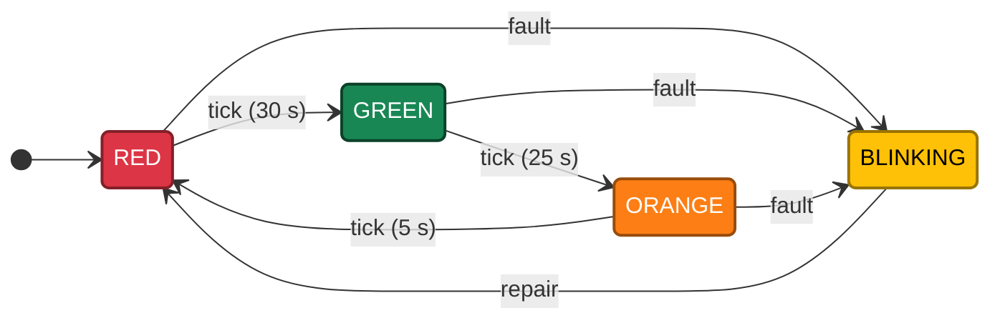
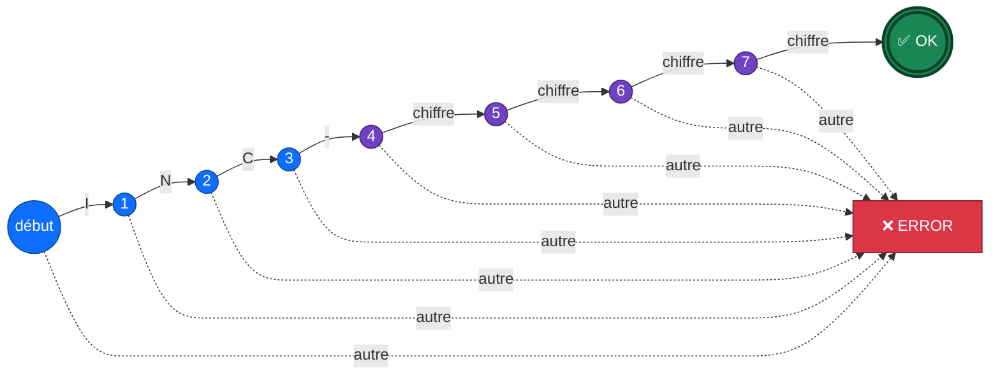

# 🧠 Séance 4 — TP : réalisation d'algorithmes

**Algorithmes classiques · Automates à états**

---

## 🎯 Objectifs

| | Compétence |
|:-:|---|
| 🔄 | Traduire un **algorithme** en Python |
| 🔢 | Implémenter **Fibonacci**, **PGCD/PPCM**, les **années bissextiles** et les **nombres premiers** |
| ⚙️ | Simuler des **automates à états** avec une table de transitions |
| 🧪 | Tester un algorithme sur des **cas connus** et des **cas limites** |

---

## 🔢 Partie 1 : algorithmes numériques (40 min)

| Algorithme | Idée clé en Python |
|---|---|
| 🌀 **Fibonacci** | `a, b = b, a + b` |
| ➗ **PGCD (Euclide)** | `while b != 0: a, b = b, a % b` |
| 🔗 **PPCM** | `a * b // pgcd` |
| 📅 **Bissextile** | `(y % 4 == 0 and y % 100 != 0) or y % 400 == 0` |
| 🔍 **Premier** | aucun diviseur `d` tel que `d * d <= n` |
| 🧹 **Crible d'Ératosthène** | barrer les multiples de `p` à partir de `p * p` |

> [!TIP]
> **Cas d'usage concret :** une sauvegarde tous les 12 jours et un audit tous les 18 jours retombent le même jour tous les **PPCM(12, 18) = 36 jours**.

---

## ⚙️ Partie 2 : automates à états (45 min)

Un automate comporte des **états**, un **état initial** et des **transitions** déclenchées par des **événements**.
En Python, on l'écrit avec une variable `state` et un dictionnaire `transitions[state][event]`.

### 🚦 Exemple : le feu tricolore avec mode clignotant

### 🎫 Exemple : reconnaître un numéro de ticket `INC-1234`

---

## 🏋️ Exercices

| # | Exercice | Difficulté | Notion clé |
|:-:|---|:-:|---|
| 1 | Les premiers termes de Fibonacci | ⭐ | cas limites `n = 0, 1, 2` |
| 2 | Premier terme qui dépasse un seuil | ⭐⭐ | `while` |
| 3 | PGCD et PPCM : planification de tâches | ⭐⭐ | Euclide |
| 4 | Années bissextiles 1900 à 2030 | ⭐ | conditions combinées |
| 5 | Un nombre est-il premier ? | ⭐⭐ | `d * d <= n`, `break` |
| 6 | Crible d'Ératosthène | ⭐⭐⭐ | liste de booléens |
| 7 | Feu tricolore avec mode clignotant | ⭐⭐ | table de transitions |
| 8 | Distributeur de boissons | ⭐⭐⭐ | états `IDLE` / `PAYING`, montants en millimes |
| 9 | Nombres binaires divisibles par 3 | ⭐⭐ | état = reste modulo 3 |
| 10 | Reconnaissance des numéros de ticket | ⭐⭐⭐ | automate et état `ERROR` |
| 🧩 | **Synthèse** : workflow d'un ticket d'incident | ⭐⭐⭐ | `NEW → … → CLOSED`, actions refusées |

---

## 🛠️ Projet fil rouge GestParc : bonus facultatif

Pas de nouvelle étape : les TP restent indépendants. Pour ceux qui ont terminé, **valider les numéros d'inventaire** au format `LT-001` (2 lettres connues, un tiret, puis 3 chiffres) et en déduire la catégorie.

🚀 **Pour aller plus loin :** suite de Syracuse, automate de connexion SSH (verrouillage après 3 échecs), nombres parfaits.

---

📓 **Notebook :** [`S04_lab_enonce.ipynb`](S04_lab_enonce.ipynb) · ⏮️ [Séance 3](../S03/)

