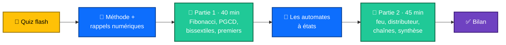
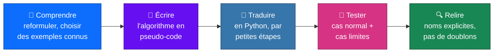
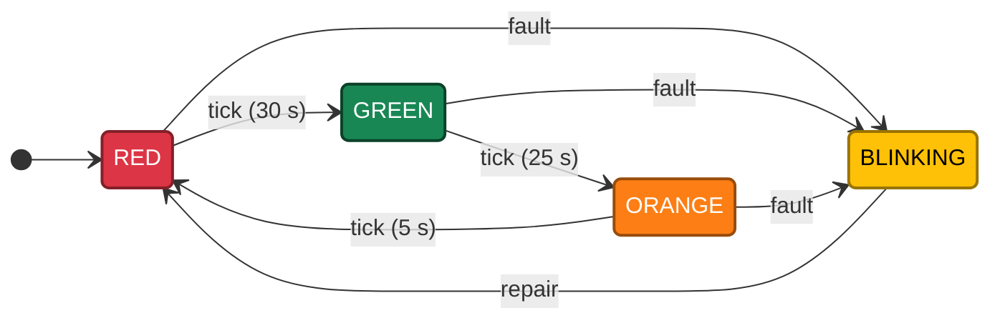
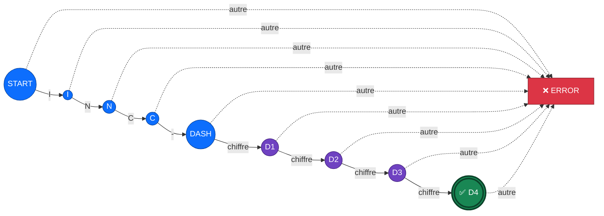

<div align="center">

# 🧠 Séance 4 — TP : réalisation d'algorithmes

**Méthode · Algorithmes classiques · Automates à états**


</div>

---

## 🎯 Objectifs de la séance

| | Compétence |
|:-:|---|
| 🔄 | Traduire un **algorithme** en Python avec des variables, des conditions et des boucles |
| 🔢 | Implémenter **Fibonacci**, le **PGCD**, les **années bissextiles** et les **nombres premiers** |
| ⚙️ | Modéliser et simuler des **automates à états** : feu tricolore, distributeur, reconnaissance de chaînes |
| 🧪 | **Tester** systématiquement son code sur des cas connus |

---

## 🗺️ Déroulé du TP



<details>
<summary><b>🧠 Quiz flash : révision de la séance 3</b> (cliquer pour voir les réponses)</summary>

| Question | Réponse |
|---|---|
| Que vaut `"ERROR" in "2026-10-21 ERROR disk full"` ? | `True` (recherche de sous-chaîne) |
| Corriger `if level == "ERROR" or "FATAL":` | `if level in ("ERROR", "FATAL"):` |
| Quand le `else` d'une boucle `for` s'exécute-t-il ? | quand la boucle se termine **sans `break`** |
| Qu'affiche `for i, s in enumerate(["a", "b"], start=1): print(i, s)` ? | `1 a` puis `2 b` |
| `msg` vaut `"pair"` si `n` est pair, sinon `"impair"` | `msg = "pair" if n % 2 == 0 else "impair"` |

</details>

---

## 🧭 La méthode de travail



> [!TIP]
> Les **cas limites** à tester : `0`, `1`, les valeurs négatives et la liste vide. Les cellules ✅ du notebook jouent le rôle de tests ; en S15, nous écrirons de vrais **tests unitaires**.

---

## 🔢 Partie 1 : algorithmes numériques (40 min)

| Algorithme | 💡 Idée clé | 🐍 En Python |
|---|---|---|
| 🌀 **Fibonacci** | F(0) = 0, F(1) = 1, F(n) = F(n-1) + F(n-2) | `a, b = b, a + b` |
| ➗ **PGCD (Euclide)** | pgcd(a, b) = pgcd(b, a % b) jusqu'à ce que b = 0 | `while b != 0: a, b = b, a % b` |
| 🔗 **PPCM** | se déduit du PGCD | `a * b // pgcd` |
| 📅 **Bissextile** | divisible par 4 et pas par 100, **ou** divisible par 400 | `(y % 4 == 0 and y % 100 != 0) or y % 400 == 0` |
| 🔍 **Premier** | aucun diviseur entre 2 et √n | tester `d * d <= n` |
| 🧹 **Crible d'Ératosthène** | barrer les multiples de chaque premier | à partir de `p * p` |

<table>
<tr><th>➗ Euclide pas à pas : PGCD(1071, 462)</th><th>🌀 Fibonacci</th></tr>
<tr><td>

| a | b | a % b |
|:-:|:-:|:-:|
| 1071 | 462 | 147 |
| 462 | 147 | 21 |
| 147 | 21 | 0 |
| **21** | 0 | ✅ |

</td><td>

```python
a, b = 0, 1
fib = []
for _ in range(10):
    fib.append(a)
    a, b = b, a + b
# [0, 1, 1, 2, 3, 5, 8, 13, 21, 34]
```

</td></tr>
</table>

> [!NOTE]
> **Cas d'usage concret :** une sauvegarde tous les 12 jours et un audit tous les 18 jours retombent le même jour tous les **PPCM(12, 18) = 36 jours**.

---

## ⚙️ Partie 2 : automates à états (45 min)

Un automate, c'est un **ensemble d'états**, un **état initial** et des **transitions** déclenchées par des **événements**.
En Python, l'**état courant** est rangé dans une variable et les **transitions** dans un dictionnaire.

### 🚦 Le feu tricolore avec mode clignotant



```python
transitions = {
    "RED":    ("GREEN", 30),   # état suivant, durée de l'état courant
    "GREEN":  ("ORANGE", 25),
    "ORANGE": ("RED", 5),
}
state, elapsed = "RED", 0
for step in range(4):
    next_state, duration = transitions[state]
    print(f"t={elapsed:>3}s : {state} pendant {duration}s")
    elapsed += duration
    state = next_state
```

```text
t=  0s : RED pendant 30s
t= 30s : GREEN pendant 25s
t= 55s : ORANGE pendant 5s
t= 60s : RED pendant 30s
```

### 🎫 Reconnaître un numéro de ticket `INC-` suivi de 4 chiffres



| État | Caractère lu | Nouvel état |
|---|---|---|
| `START` | `I` | `I` |
| `I` | `N` | `N` |
| `N` | `C` | `C` |
| `C` | `-` | `DASH` |
| `DASH`, `D1`, `D2`, `D3` | un chiffre | `D1`, `D2`, `D3`, `D4` |
| tout autre cas | … | `ERROR` (état absorbant) |

> [!IMPORTANT]
> La chaîne est **acceptée** si l'automate termine dans l'état **`D4`**. Exemple : `INC-2048` ✅, `INC-20A8` ❌, `INC-20481` ❌.

---

## 🏋️ Exercices du lab

| # | Exercice | Difficulté | Notion clé |
|:-:|---|:-:|---|
| 1 | Les n premiers termes de Fibonacci | ⭐ | cas limites `n = 0, 1, 2` |
| 2 | Premier terme qui dépasse un seuil | ⭐⭐ | `while` |
| 3 | PGCD et PPCM : planification de tâches | ⭐ / ⭐⭐ | Euclide |
| 4 | Années bissextiles de 1900 à 2030 | ⭐ | conditions combinées |
| 5 | Un nombre est-il premier ? | ⭐⭐ | `d * d <= n`, `break` |
| 6 | Crible d'Ératosthène | ⭐⭐⭐ | liste de booléens |
| 7 | Feu tricolore avec mode clignotant | ⭐⭐ | table de transitions |
| 8 | Distributeur de boissons (monnaie, rendu) | ⭐⭐⭐ | états `IDLE` / `PAYING`, montants en millimes |
| 9 | Nombres binaires divisibles par 3 | ⭐⭐ | état = reste modulo 3 |
| 10 | Reconnaissance des numéros de ticket | ⭐⭐⭐ | automate et état `ERROR` |
| 🧩 | **Synthèse** : workflow d'un ticket d'incident | ⭐⭐⭐ | `NEW → … → CLOSED`, actions refusées |

---

## 🛠️ Projet fil rouge GestParc : bonus facultatif

Pas de nouvelle étape : les TP restent indépendants. Pour ceux qui ont terminé, **validez les numéros d'inventaire** au format `LT-001` (2 lettres connues, un tiret, 3 chiffres) et déduisez-en la catégorie.

🚀 **Pour aller plus loin :** suite de Syracuse, automate de connexion SSH (verrouillage après 3 échecs), nombres parfaits.

---

## ✅ Bilan du TP

| | À retenir |
|:-:|---|
| 🧪 | un algorithme se teste sur des **cas connus** et des **cas limites** |
| 🔄 | le motif `a, b = b, a + b` évite les variables temporaires |
| 🔁 | `while` convient quand on **ne connaît pas** le nombre de tours (Euclide, seuil) |
| ⚙️ | un automate = **état courant** + **table de transitions** (dictionnaire) |
| 🔁 | le code de cette séance contient beaucoup de **répétitions**… |

➡️ **Séance 5 :** les **fonctions**, pour rendre ces algorithmes réutilisables.

---

<div align="center">

📓 **Notebook :** [`S04_lab_enonce.ipynb`](S04_lab_enonce.ipynb) · ⏮️ [Séance 3](../S03/)

</div>
