<!-- _class: title -->
<!-- _paginate: false -->
<!-- _header: '' -->

# Séance 9
## Héritage et polymorphisme

**Objectifs de la séance**
- Mettre en place une hiérarchie de classes avec l'héritage simple et `super()`
- Redéfinir et étendre des méthodes
- Comprendre l'héritage multiple, le MRO et les mixins
- Exploiter le polymorphisme et le duck typing
- Définir des classes abstraites avec le module `abc`

<!--
Timing : 1 min.
Module 5. On repart des duplications relevées au bilan de S8 (Player / Enemy).
-->

---

<!-- _class: quiz -->

## ⚡ Quiz flash : séance 8

1. Dans le moteur de jeu, pourquoi `play_turn` renvoie-t-elle des messages au lieu de les afficher ?
2. Quelle est la différence entre composition et agrégation en UML ?
3. Comment borner les PV entre 0 et le maximum ?
4. Que renvoie `items.pop((3, 0), None)` si aucune clé ne correspond ?
5. Quels attributs et méthodes `Player` et `Enemy` ont-ils en commun ?

<!--
Timing : 10 min.
Réponses : 1. pour pouvoir tester le moteur sans clavier et changer d'interface — 2. composition : la partie n'existe pas sans le tout (losange plein) ; agrégation : simple référence (losange vide) — 3. min/max — 4. None — 5. entity, attack, defense, strike (=> héritage !).
-->

---

## Plan de la séance

| Durée | Bloc |
|---|---|
| 10 min | Quiz flash |
| 20 min | Théorie 1 : héritage simple, `super()`, redéfinition |
| 30 min | 🧪 Lab partie 1 : hiérarchie de personnages du moteur de jeu |
| 5 min | Pause |
| 20 min | Théorie 2 : héritage multiple, MRO, mixins, polymorphisme, `abc` |
| 30 min | 🧪 Lab partie 2 + GestParc étape 6 |
| 5 min | Récapitulatif |

---

## Le principe de l'héritage

Une **classe fille** hérite des attributs et méthodes d'une **classe mère**, puis les complète ou les modifie.

<div class="cols">
<div>



</div>
<div>

- `Player` **est un** `Character`
- `Boss` **est un** `Enemy`, donc **est un** `Character`
- Le code commun est écrit **une seule fois**
- Relation « est un » ≠ « a un » (composition)

</div>
</div>

<!--
Timing : 3 min.
Test pour choisir : « un Boss EST un Enemy » (héritage) vs « un Player A une Entity » (composition).
En cas de doute, préférer la composition.
-->

---

## Héritage simple et `super()`

```python
class Character:
    def __init__(self, name: str, hp: int, attack: int, defense: int) -> None:
        self.name, self.hp = name, hp
        self.attack, self.defense = attack, defense

    def strike(self, target: "Character") -> int:
        damage = max(1, self.attack - target.defense)
        target.hp -= damage
        return damage

class Player(Character):                       # Player hérite de Character
    def __init__(self, name: str) -> None:
        super().__init__(name, hp=30, attack=5, defense=2)   # constructeur parent
        self.xp = 0                                           # attribut en plus

aya = Player("Aya")
print(aya.name, aya.hp, aya.xp, aya.strike(Character("Rat", 5, 1, 0)))
```

```text
Aya 30 0 5
```

<!--
Timing : 4 min.
super() renvoie un objet qui délègue à la classe parente.
Oublier super().__init__ : les attributs du parent ne sont pas créés => AttributeError plus tard.
-->

---

## Redéfinir et étendre une méthode

```python
class Enemy(Character):
    def __str__(self) -> str:
        return f"{self.name} ({self.hp} PV)"

class Boss(Enemy):
    def __init__(self, name: str, hp: int, attack: int, defense: int) -> None:
        super().__init__(name, hp, attack, defense)
        self.max_hp = hp

    def strike(self, target: Character) -> int:          # redéfinition
        bonus = 3 if self.hp < self.max_hp / 2 else 0     # enragé
        self.attack += bonus
        damage = super().strike(target)                   # extension
        self.attack -= bonus
        return damage

    def __str__(self) -> str:
        return "👑 " + super().__str__()

print(Boss("Dragon", 50, 12, 4))
```

```text
👑 Dragon (50 PV)
```

<!--
Timing : 4 min.
Redéfinition (override) : même nom, même signature, comportement différent.
Extension : on appelle super().methode() pour réutiliser le comportement parent, puis on ajoute le sien.
-->

---

## Tester les relations : `isinstance` et `issubclass`

```python
dragon = Boss("Dragon", 50, 12, 4)
print(isinstance(dragon, Boss), isinstance(dragon, Enemy), isinstance(dragon, Character))
print(isinstance(dragon, Player), issubclass(Boss, Character))
print(type(dragon).__name__, Boss.__bases__)
```

```text
True True True
False True
Boss (<class '__main__.Enemy'>,)
```

- Toute classe hérite finalement de `object` (d'où `__str__`, `__eq__` par défaut…)
- `isinstance` respecte l'héritage, `type(x) == C` non : préférer `isinstance`

<!--
Timing : 2 min.
Rappel S2 : c'était la raison de préférer isinstance à type().
-->

---

<!-- _class: lab -->

## 🧪 À vous : Lab partie 1 (30 min)

Notebook **`S09_lab_enonce.ipynb`**, partie 1

- Ex. 1 ⭐ : `Manager` hérite d'`Employee`
- Ex. 2 ⭐⭐ : notifications e-mail et SMS (redéfinition + `super()`)
- Ex. 3 ⭐⭐ : la hiérarchie de personnages du moteur de jeu (`Character`, `Player`, `Enemy`, `Boss`)
- Ex. 4 ⭐ : `isinstance`, `issubclass` et filtrage par type

---

## Héritage multiple et MRO

```python
class A:
    def who(self) -> str: return "A"
class B(A):
    def who(self) -> str: return "B → " + super().who()
class C(A):
    def who(self) -> str: return "C → " + super().who()
class D(B, C):
    def who(self) -> str: return "D → " + super().who()

print(D().who())
print([cls.__name__ for cls in D.__mro__])
```

```text
D → B → C → A
['D', 'B', 'C', 'A', 'object']
```

**MRO** (*Method Resolution Order*) : l'ordre dans lequel Python cherche une méthode. `super()` suit le MRO, pas seulement « la » classe mère.

<!--
Timing : 3 min.
Le losange (diamant) : A n'est appelé qu'une fois.
L'ordre des classes mères dans la déclaration compte : class D(B, C).
-->

---

## Les mixins

Un **mixin** : une petite classe qui **ajoute une capacité** sans être une « vraie » classe mère.

```python
class ReprMixin:
    def __repr__(self) -> str:
        fields = ", ".join(f"{k}={v!r}" for k, v in vars(self).items())
        return f"{type(self).__name__}({fields})"

class TimestampMixin:
    def touch(self, when: str) -> None:
        self.updated_at = when

class Ticket(ReprMixin, TimestampMixin):
    def __init__(self, ticket_id: str) -> None:
        self.ticket_id = ticket_id

t = Ticket("INC-0042")
t.touch("2026-10-21")
print(repr(t))
```

```text
Ticket(ticket_id='INC-0042', updated_at='2026-10-21')
```

<!--
Timing : 3 min.
Convention : suffixe Mixin, placé AVANT la classe principale dans la liste des bases.
Dans GestParc : NetworkMixin ajoute une adresse IP aux serveurs, imprimantes et équipements réseau, mais pas aux portables.
-->

---

## Le polymorphisme

Un même appel, un comportement **adapté au type réel** de l'objet.

```python
class Laptop:
    def maintenance_months(self) -> int: return 24
class Server:
    def maintenance_months(self) -> int: return 6
class Printer:
    def __init__(self, pages: int) -> None: self.pages = pages
    def maintenance_months(self) -> int: return 3 if self.pages > 50_000 else 12

park = [Laptop(), Server(), Printer(62_000), Printer(1_200)]
print([item.maintenance_months() for item in park])
```

```text
[24, 6, 3, 12]
```

**Duck typing** : « si ça marche comme un canard… » — Python ne vérifie pas le type, seulement que la méthode existe.

<!--
Timing : 3 min.
Ici, les classes n'ont même pas de parent commun : c'est du duck typing pur.
Avantage : on ajoute un nouveau type sans modifier la boucle (principe ouvert/fermé).
-->

---

## Les classes abstraites : le module `abc`

```python
from abc import ABC, abstractmethod

class Equipment(ABC):
    @abstractmethod
    def maintenance_months(self) -> int:
        """Chaque type d'équipement DOIT définir sa périodicité."""

class Laptop(Equipment):
    def maintenance_months(self) -> int:
        return 24

print(Laptop().maintenance_months())
Equipment()
```

```text
24
TypeError: Can't instantiate abstract class Equipment without an implementation
for abstract method 'maintenance_months'
```

- Une classe abstraite **ne peut pas être instanciée**
- Elle impose un **contrat** aux sous-classes

<!--
Timing : 3 min.
Duck typing (souple) vs ABC (contrat explicite, erreur dès l'instanciation).
On peut aussi déclarer des propriétés abstraites (@property + @abstractmethod).
-->

---

## Pièges fréquents

| Piège | Symptôme | Correction |
|---|---|---|
| Oublier `super().__init__()` | `AttributeError` sur un attribut du parent | appeler le constructeur parent |
| Héritage pour réutiliser du code « par hasard » | hiérarchie incohérente | test « est un » ; sinon composition |
| Ordre des bases d'un mixin | méthode du mixin ignorée | `class Server(NetworkMixin, Equipment)` |
| `type(x) == Parent` | faux pour les sous-classes | `isinstance(x, Parent)` |
| Méthode abstraite oubliée | `TypeError` à l'instanciation | implémenter toutes les méthodes abstraites |
| Hiérarchie trop profonde | code difficile à suivre | 2 ou 3 niveaux au maximum |

---

<!-- _class: lab -->

## 🧪 À vous : Lab partie 2 (30 min)

Notebook **`S09_lab_enonce.ipynb`**, parties 2 et 3

- Ex. 5 ⭐⭐ : prédire le MRO
- Ex. 6 ⭐⭐ : des mixins réutilisables
- Ex. 7 ⭐⭐ : exports polymorphes (CSV, Markdown, texte)
- Ex. 8 ⭐⭐⭐ : stratégies de sauvegarde avec une classe abstraite
- Synthèse : contrôles de supervision (abstraction + duck typing)
- **GestParc – étape 6** : hiérarchie d'équipements



---

## Récapitulatif

- `class Fille(Mere)` · `super().__init__(...)` · redéfinition et extension avec `super()`
- `isinstance` / `issubclass` respectent l'héritage
- Héritage multiple : le **MRO** (`Classe.__mro__`) ; **mixins** pour ajouter des capacités
- **Polymorphisme** : même appel, comportement selon l'objet ; **duck typing**
- `ABC` + `@abstractmethod` : contrat imposé aux sous-classes

**Séance 10** : la gestion des exceptions

<!--
Timing : 5 min.
Annonce : en S10, les setters qui « refusent avec un message » vont lever de vraies exceptions.
-->
